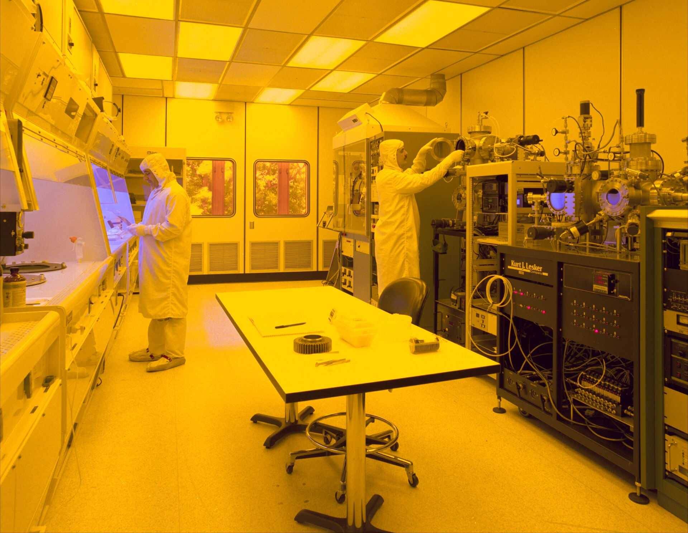

  <!-- GIF MULTIMEDIA DE CABECERA: Simulación orbital / Tierra -->
  

    

  <!-- TEXTO ANIMADO DINÁMICO (Efecto Terminal Neón) -->
  

  
  

---

### 🚀 Resumen de Misión

> **Objetivo Principal:** Diseño, construcción y programación integral de un satélite funcional para su despliegue orbital.

- 🔭 **Enfoque Técnico:** Arquitectura tolerante a fallos, algoritmos de control de actitud (GNC) y sistemas embebidos de tiempo real (RTOS).
- 💡 **Filosofía Operativa:** El código espacial no admite parches post-lanzamiento; exige precisión absoluta matemática y optimización extrema de recursos a nivel de hardware.
- 🛠️ **Laboratorio R&D (Hobbies):** Desarrollo de algoritmos experimentales, optimización de estructuras de datos y tooling auxiliar en mis repositorios públicos.

---

### 🛰️ Ensamblaje y Operaciones (Clean Room)

  <!-- IMAGEN NASA ROBUSTA (Alojada en Wikimedia para evitar bloqueos de GitHub) -->
  
  
<em>NASA Spacecraft Assembly & Payload Integration Facility. Integración de sistemas críticos.</em>

---

### 💻 Stack Tecnológico de Vuelo

  <!-- ÍCONOS VIBRANTES DE TECNOLOGÍAS -->
  

---

### 📊 Telemetría de GitHub

  <!-- ESTADÍSTICAS CON TEMA TOKYONIGHT (Resalta en modo oscuro) -->
  
  

